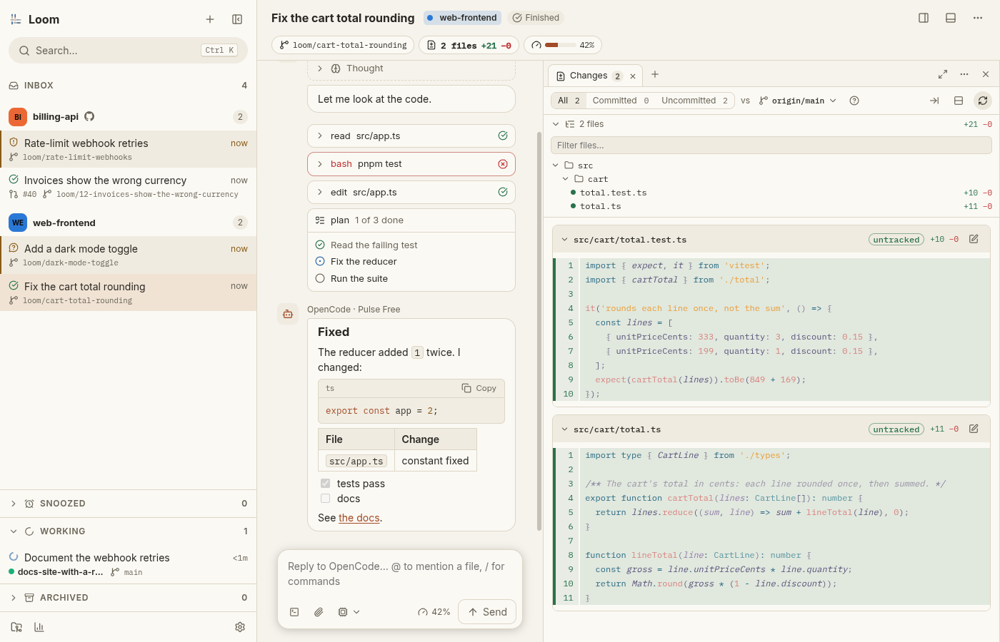
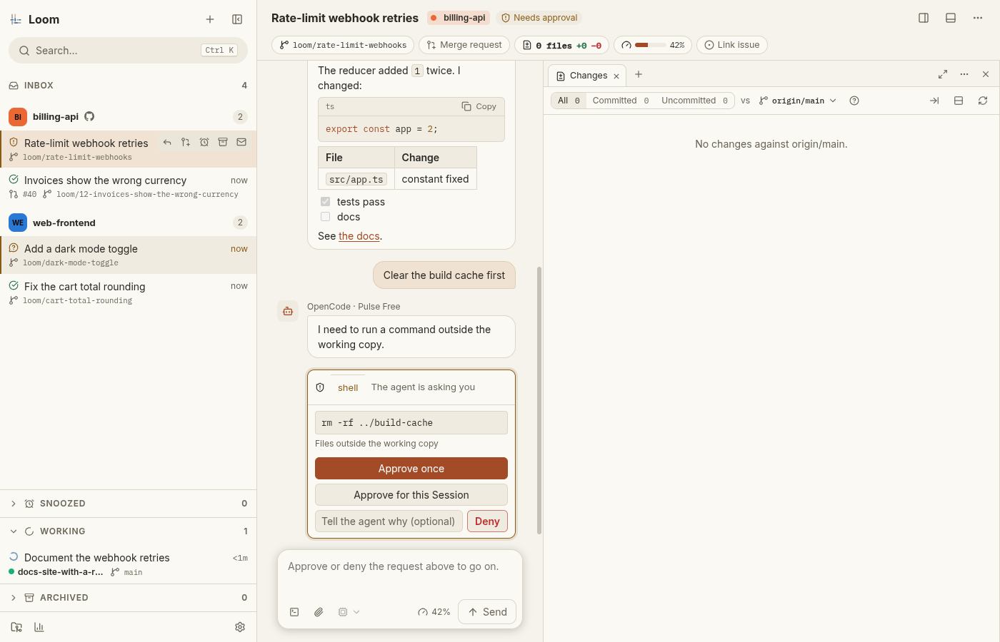
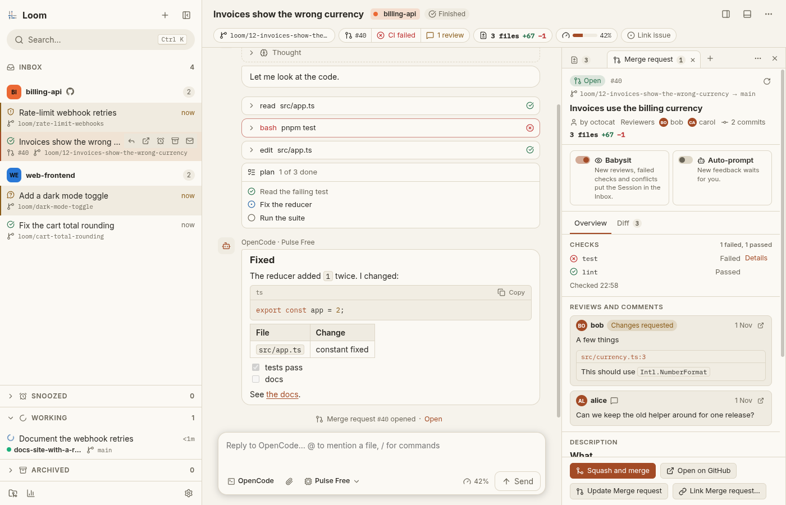

<p align="center">
  <picture>
    <source media="(prefers-color-scheme: dark)" srcset="assets/logo-dark.svg">
    
  </picture>
</p>

<h1 align="center">Loom</h1>

<p align="center">One window for all your coding agents, across all your projects.<br>Loom shows you the sessions that need you, and keeps the rest out of the way.</p>

<p align="center">
  <picture>
    <source media="(prefers-color-scheme: dark)" srcset="docs/screenshots/session-dark.png">
    
  </picture>
</p>

## What it is

Loom is a desktop app that runs AI coding agents on your own machine. Each piece of work is a **Session**: one agent conversation, in its own git worktree of a **Project** (a git checkout you add). You can have many Sessions going at once, on as many Projects as you like.

A Session is either **Working** (the agent is busy) or **Waiting** (it needs you: it finished, asked a question, wants an approval, hit an error or got stuck). The **Inbox** lists only the Waiting ones, grouped by Project, so you go from one thing that needs you to the next instead of watching terminals.

Loom has no server and no account of its own. It drives the agent you already have installed, and reaches GitHub and GitLab through your own `gh` and `glab` logins.

## Features

- **Inbox of Waiting Sessions**, with unread markers, Snooze, Archive and Undo. Move through it with `j` and `k`.
- **One worktree per Session**, on a new or an existing branch, or in the checkout itself.
- **Approvals and questions**: the agent pauses before it acts outside its working copy, and you approve once, for the Session, or deny with a reason.
- **Changes Panel**: the Session's diff against its base, with comments on the lines you pick that go out with your next message, and a full-size Review mode.
- **Merge requests** on GitHub and GitLab: create or link one, read its checks and reviews, reply to and resolve review threads, squash and merge.
- **Babysit**: Loom watches a Session's open Merge request and brings it back to the Inbox on new reviews, failed checks or conflicts. It can prompt the agent for you.
- **Issues**: start a Session from an issue and keep it open in a Panel beside the conversation.
- **Terminal** in the Session's working copy, plus "Open in editor" with your own editor.
- **Panels** (Changes, Merge request, Issue, Highlights, Terminal) that you arrange in a Side area and a Dock.
- **Command palette** and search across every conversation.
- **Usage dashboard**, desktop notifications, five themes, and remappable keyboard shortcuts.

<table>
  <tr>
    <td align="center" width="50%">
      <picture>
        <source media="(prefers-color-scheme: dark)" srcset="docs/screenshots/approval-dark.png">
        
      </picture>
      <br>The agent asks before it acts outside its working copy.
    </td>
    <td align="center" width="50%">
      <picture>
        <source media="(prefers-color-scheme: dark)" srcset="docs/screenshots/merge-request-dark.png">
        
      </picture>
      <br>A Session's Merge request, with its checks and reviews.
    </td>
  </tr>
</table>

<p align="center"><sub>The screenshots show Loom's test sandbox, where a scripted agent stands in for a real one, in the Paper and Nord themes.</sub></p>

## Requirements

- **Linux** (x64) or **Windows** (x64). On Windows, a Project can live on Windows itself or in a WSL distro. macOS is not supported yet.
- **git**.
- **[OpenCode](https://opencode.ai)** 2.1.4 or newer, installed and signed in. It is the only agent Loom drives today; Claude Code and Codex are arriving soon.
- **`gh`** and/or **`glab`**, signed in, for the Merge request and issue features on GitHub and GitLab. Loom works without them, with those features off.

## Installation

There is no release yet. Once there is, this section will point at an AppImage for Linux and an installer for Windows on the [releases page](https://github.com/theholocoder/loom/releases).

Until then, run Loom from source. Tool versions (Node 24, pnpm 10, Go 1.27, just) are pinned in `mise.toml`, so with [mise](https://mise.jdx.dev) installed:

```bash
git clone https://github.com/theholocoder/loom.git
cd loom
mise install        # the pinned tools, just among them
just install        # the dependencies
just dev            # build the bridge and start Loom
```

## Getting started

1. Start Loom. The welcome screen says whether OpenCode is found and ready.
2. Add a Project (`Ctrl O`): pick a git checkout on your machine.
3. Start a Session (`Ctrl N`): choose the Project, type what you want done, and send.
4. Carry on with something else. The Session shows up in the Inbox when it needs you.

### Keyboard shortcuts

| Shortcut | Action |
|---|---|
| `Ctrl K` | Command palette |
| `Ctrl ?` | List every shortcut |
| `Ctrl N` | New Session |
| `Ctrl Shift N` | New Session from an issue |
| `j` / `k` | Next / previous Waiting Session |
| `Ctrl 1…9` | Open the nth Session of the Inbox |
| `r` | Reply |
| `e` | Archive |
| `d` | Toggle the diff |
| `Ctrl Shift M` | Show or create the Merge request |
| `` Ctrl ` `` | Toggle the terminal |
| `Ctrl ,` | Settings |

Most of them can be remapped in Settings.

## Development

To work on Loom itself, see [docs/development.md](docs/development.md): the repository layout, the common tasks and the test suites.
